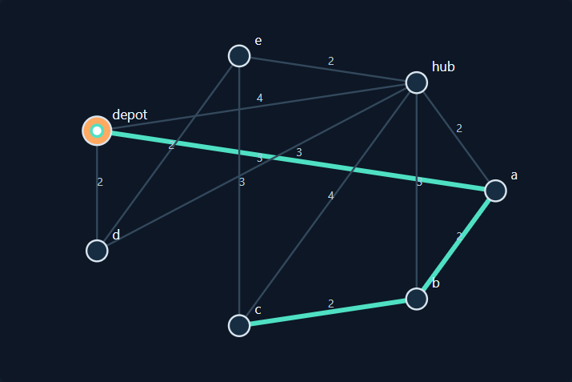

# Measured results and limits

The example's runtime computes its own results and reads its own AxolDB data. historical-results.json is a reviewed aggregate of accepted earlier studies, explicitly not a runtime fixture. Private prompts/responses, full private benchmark captures and databases are excluded.

## Public walkthrough

The two deterministic agents produce costs 24 → 24 (nearest-next) and 22 → 22 (cost-aware) across two Generations. Ordered routes change in Generation 1, but total cost does not improve. Both Generations contain Scenario, two FleetPlans, two AgentStates and an atomic checkpoint. A fresh application process resumes from Generation 0; completed-run resume adds no third Generation. The reference Fork retains its birth membership.

The public adaptation was tested with the official 0.1.2.dev1 SDK against a fresh dedicated 0.1.2 instance namespace on Windows. Strict TLS and separate scoped principals were used. Separate trusted native integer/midpoint fixtures and fresh persisted-lineage readback passed. No historical Population was changed.

## Deterministic research reference

Five related synthetic scenarios, ten fixed seeds each, 20 Generations per arm and 48 scored proposals per Generation produced 50 paired trials, 100 arm runs and 96,000 experimental evaluations. The evolutionary arm's mean final best-cost advantage over independent construction was 2.84 cost units, conditional stratified-bootstrap 95% interval [2.60,3.20], with 20 wins, 30 ties and zero losses.

The two-sided paired Monte Carlo sign-flip p-value was 0.00003052 at its 32,768-draw plus-one resolution floor; paired standardized dz was approximately 0.717. This is a limited fixed-family result, not general superiority. Equal candidate evaluation counts do not mean equal computational work. None of the independent lower-bound/reference pairs proved a global optimum. The 2,000 application Generations were not individually persisted as 2,000 native Generations: six native benchmark audit Generations held the selected experiment evidence.

## Local representation study

Eighteen gemma3:4b calls were allocated six each to Direct FleetPlan, Permutation and Bounded Mutation representations. Feasible counts were 3/6, 6/6 and 1/6 respectively. Mutation received a valid parent and is not independent full-plan construction. This small engineering study motivated a bounded permutation pilot, not a general model ranking.

## Local permutation evolutionary pilot

Three fixed seeds, three arms, six Generations and population six used 279 scored evaluations: 31 per seed/arm, 93 per arm. A was deterministic evolution, B added local-model permutations and C added independently generated deterministic permutations.

All 15 local model proposals were valid and feasible, but all yielded the same cost-28 plan. **Zero proposals were admitted; no optimization benefit from LLM proposals was measured.** C admitted 2/15 proposals, with no positive marginal-best contribution. Final best costs:

| Seed | A | B | C |
|---|---:|---:|---:|
| 71011 | 22 | 22 | 22 |
| 71023 | 22 | 24 | 24 |
| 71039 | 22 | 22 | 22 |

Paired B minus C differences were 0/0/0; mean zero, exhaustive-bootstrap interval [0,0], exact sign-flip p=1. This degenerate three-pair interval does not prove universal equivalence. The frozen feasibility/marginal-contribution/paired-cost continuation criterion was not met. A successful persistence and replay implementation is not evidence of useful model optimization.

Historical usage was 3,930 input plus 285 output tokens. Warm median request latency was about 2.06 seconds; first request about 32.37 seconds including about 29.64 seconds of provider-reported cold loading. These measurements belong to the accepted local model/runtime/hardware configuration, not a public performance guarantee.

## Replay and boundaries

Recorded-response replay reproduces evaluation of retained bytes without inference. It does not imply identical future live generation. The supplied authored synthetic recording tests plumbing only and must not be used as evidence for historical model behavior.

FleetPlan evolution is application-level. AxolDB persists governed facts, membership and provenance and separately supports specific trusted native integer mutation and binary crossover. This example does not show that AxolDB improves optimization quality, prove global optimality or establish general LLM inferiority. No full clean-host, all-platform, production-scale or native interrupted-Evolution recovery claim is made.

This real accepted dashboard capture excludes private identifiers and is illustrative evidence only; the runnable web API never substitutes it for database data.
